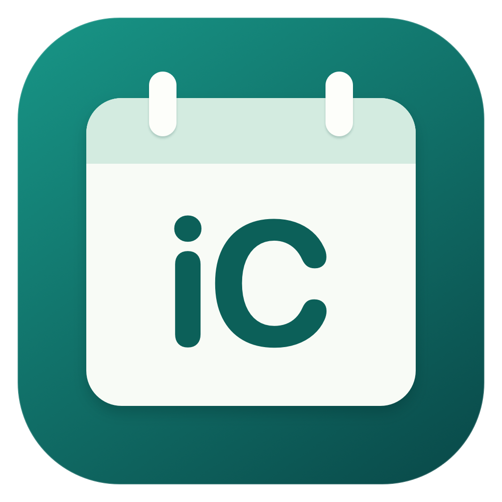
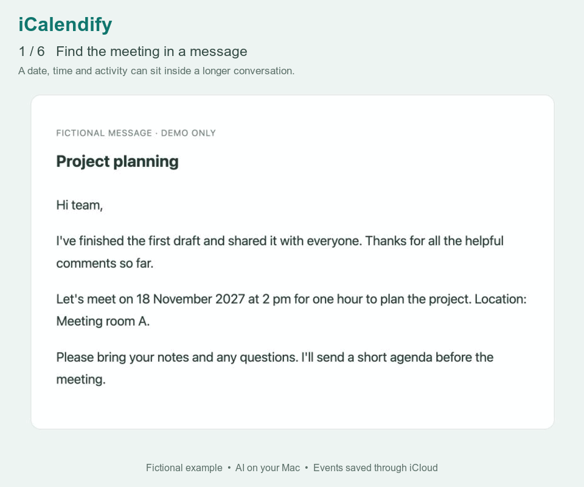

# iCalendify

### Turn selected text into calendar events with your Mac’s AI

[Install](#install) · [Use](#use) · [Privacy](docs/GUIDE.md#privacy) · [License](LICENSE)

iCalendify uses the on-device Apple Foundation Model built into Apple Intelligence on your Apple silicon Mac to create clear titles from the text you select. It also detects dates and times, so you can review the details, choose your iCloud calendar, and save.

**On-device AI, private by design.** Your selected text is processed on your Mac, not sent to a cloud AI service. Events and their notes sync through iCloud only when you save them.

## Install

You need an **Apple silicon Mac with macOS 26 or later** and iCloud Calendar enabled.

1. [Download iCalendify for Mac (.dmg)](https://github.com/Alihjt/iCalendify/releases/download/v0.1.0/iCalendify-0.1.0-arm64.dmg).
2. Open it and drag **iCalendify** into **Applications**.
3. Open iCalendify, click **Load calendars**, allow Calendar access, and tick your iCloud calendar.

**This early release is not notarized by Apple.** If macOS blocks it and you trust the download, try opening it, then go to **System Settings → Privacy & Security → Open Anyway**. [Apple's explanation](https://support.apple.com/102445).

No Terminal or Xcode is needed. Prefer to build it yourself? [Build from source](docs/GUIDE.md#build-from-source).

For AI titles, enable **Apple Intelligence** in System Settings and let macOS download its model. Manual entry works without AI.

## Use

Highlight text → right-click → **Services → Add to Calendar with iCalendify**.

Check the title, date, year, time, and calendar, then click **Add to Calendar**. The selected text is saved in the event's notes. You can also open iCalendify and paste text directly.

If the menu item is missing, enable it in **System Settings → Keyboard → Keyboard Shortcuts → Services → Text**.

[More help and privacy details](docs/GUIDE.md) · [MIT license](LICENSE)

Vibe-coded with **OpenAI Codex**.
